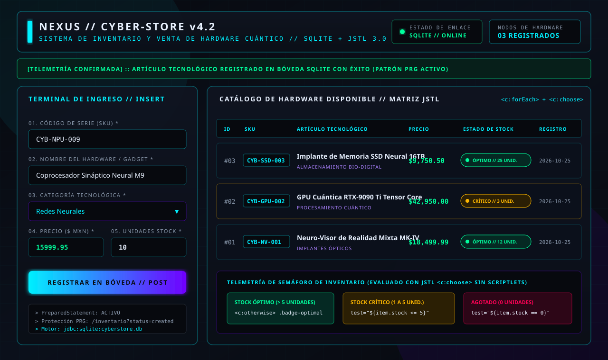
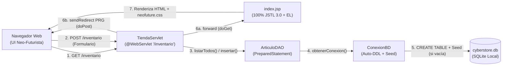

# NEXUS // CYBER-STORE v4.2 — Sistema de Inventario y Venta de Hardware Cuántico


Aplicación web académica desarrollada en **Java** bajo una estética de **Neo-Futurismo Espacial**, diseñada para gestionar el inventario de artículos tecnológicos de alta gama (*Cyber-Store*). El sistema implementa el patrón arquitectónico **MVC + DAO** utilizando **Servlets 6.0**, **JSP + JSTL 3.0 puro (cero Scriptlets)** y una base de datos local **SQLite auto-inicializable** que no requiere configuración manual externa.

---

## Vista Previa de la Interfaz (Neo-Futurismo)



### Características de la Interfaz (`assets/css/neofuture.css` + `index.jsp`)
1. **HUD Superior de Telemetría:** Muestra el estado de enlace con SQLite (`ONLINE`) y el contador dinámico de nodos de hardware registrados (`${totalArticulos}`).
2. **Panel Izquierdo — Terminal de Ingreso (`POST /inventario`):** Formulario validado para registrar nuevos artículos con protección contra reenvío de formularios mediante el patrón **PRG (*Post-Redirect-Get*)**.
3. **Panel Derecho — Catálogo de Hardware Disponible (`GET /inventario`):** Matriz tabular generada dinámicamente con `<c:forEach>`, escapado seguro contra XSS vía `<c:out>`, formato monetario con `<fmt:formatNumber>` y semáforo de stock mediante `<c:choose>`:
   - **Óptimo (`stock > 5`):** Badge verde/cian bioluminiscente (`ÓPTIMO // N UNIDADES`).
   - **Stock Crítico (`1 <= stock <= 5`):** Badge ámbar pulsante (`STOCK CRÍTICO // N UNIDADES`).
   - **Agotado (`stock == 0`):** Badge carmesí neón (`AGOTADO // 0 UNIDADES`).

---

## 1. Stack Tecnológico y Dependencias

| Componente | Tecnología / Librería | Versión | Propósito |
| :--- | :--- | :--- | :--- |
| **Empaquetado** | Java Web Application (`war`) | `1.0-SNAPSHOT` | Artefacto desplegable en contenedores de Servlets |
| **Contenedor Objetivo** | Apache Tomcat | `10.1+` | Soporte nativo para **Jakarta EE 10** (`jakarta.servlet.*`) |
| **API de Servlets** | `jakarta.servlet:jakarta.servlet-api` | `6.0.0` | `compileOnly` (provisto por Tomcat) |
| **JSTL API** | `jakarta.servlet.jsp.jstl:jakarta.servlet.jsp.jstl-api` | `3.0.2` | Etiquetas estándar `jakarta.tags.core` y `jakarta.tags.fmt` |
| **JSTL Implementación** | `org.glassfish.web:jakarta.servlet.jsp.jstl` | `3.0.1` | Motor de ejecución JSTL 3.0 |
| **Base de Datos** | `org.xerial:sqlite-jdbc` | `3.46.1.3` | Driver JDBC embebido para el archivo local `cyberstore.db` |
| **Pruebas** | `org.junit.jupiter:junit-jupiter` | `5.10.3` | Pruebas automatizadas de auto-inicialización, `SELECT` e `INSERT` |

---

## 2. Arquitectura del Sistema (MVC + DAO)



### Base de Datos SQLite Auto-Inicializable (`ConexionBD.java`)
Al clonarse el repositorio y ejecutarse por primera vez, `ConexionBD.obtenerConexion()` realiza automáticamente:
1. Carga del driver `org.sqlite.JDBC` y apertura de `jdbc:sqlite:cyberstore.db`.
2. Ejecución de `CREATE TABLE IF NOT EXISTS articulos (...)`.
3. Verificación del conteo de filas (`SELECT COUNT(*) FROM articulos`). Si es `0`, inserta automáticamente **3 artículos tecnológicos semilla (*seed*)**:
   - `CYB-NV-001` — **Neuro-Visor de Realidad Mixta MK-IV** (`Implantes Ópticos`, `$18,499.99`, `12` unidades).
   - `CYB-GPU-002` — **GPU Cuántica RTX-9090 Ti Tensor Core** (`Procesamiento Cuántico`, `$42,950.00`, `3` unidades — *demuestra el estado de Stock Crítico*).
   - `CYB-SSD-003` — **Implante de Memoria SSD Neural 16TB** (`Almacenamiento Bio-Digital`, `$9,750.50`, `25` unidades).

---

## 3. Estructura del Proyecto

```text
proyecto3-000000267239-DW/
├── docs/
│   └── screenshots/
│       └── cyberstore-preview.svg                 # Captura vectorial de la interfaz Neo-Futurista
├── src/
│   ├── main/
│   │   ├── java/mx/edu/itson/cyberstore/
│   │   │   ├── config/
│   │   │   │   └── ConexionBD.java                # Conexión SQLite + Auto-DDL + Seed de 3 artículos
│   │   │   ├── model/
│   │   │   │   └── Articulo.java                  # POJO / JavaBean (id, sku, nombreProducto, categoria, precio, stock, fechaRegistro)
│   │   │   ├── dao/
│   │   │   │   └── ArticuloDAO.java               # SELECT e INSERT con PreparedStatement y try-with-resources
│   │   │   └── controller/
│   │   │       └── TiendaServlet.java             # Controlador MVC (/inventario) con doGet, doPost y patrón PRG
│   │   └── webapp/
│   │       ├── assets/css/
│   │       │   └── neofuture.css                  # Estilos Neo-Futuristas, Glassmorphism y diseño responsivo
│   │       ├── WEB-INF/
│   │       │   └── web.xml                        # Descriptor Jakarta EE 10 (Servlet 6.0)
│   │       └── index.jsp                          # Vista principal con JSTL puro (Cero Scriptlets)
│   └── test/
│       └── java/mx/edu/itson/cyberstore/dao/
│           └── ArticuloDAOTest.java               # Test JUnit 5 de auto-init, seed, INSERT y SELECT
├── .gitignore                                     # Reglas de exclusión para Gradle, IntelliJ y archivos .db
├── build.gradle.kts                               # Configuración de compilación y empaquetado WAR
├── settings.gradle.kts                            # Nombre del proyecto raíz
└── README.md                                      # Documentación y guía de despliegue
```

---

## 4. Instrucciones de Compilación y Empaquetado (Gradle)

### Requisitos Previos
- **JDK 17 o superior** instalado y configurado en `JAVA_HOME` (probado y verificado también en **JDK 22**).
- No es necesario instalar Gradle ni SQLite manualmente; el proyecto incluye **Gradle Wrapper** (`./gradlew` / `gradlew.bat`) y el driver embebido `sqlite-jdbc`.

### Comandos de Construcción

1. **Clonar el repositorio:**
   ```bash
   git clone https://github.com/Josuesitoio/proyecto3-000000267239-DW.git
   cd proyecto3-000000267239-DW
   ```

2. **Ejecutar pruebas automatizadas y generar el archivo `.war`:**
   - En **Windows (PowerShell / CMD):**
     ```powershell
     .\gradlew.bat clean test war
     ```
   - En **Linux / macOS:**
     ```bash
     ./gradlew clean test war
     ```

3. **Verificar el artefacto generado:**
   Al finalizar con `BUILD SUCCESSFUL`, el paquete desplegable se encontrará en:
   ```text
   build/libs/proyecto3-000000267239-DW-1.0-SNAPSHOT.war
   ```

---

## 5. Guía de Despliegue en Apache Tomcat 10.1+

### Opción A: Despliegue directo en carpeta `webapps` de Tomcat 10.1+
1. Descargue e instale **Apache Tomcat 10.1.x** (compatible con Jakarta EE 10 / Servlet 6.0).
2. Copie el archivo generado `build/libs/proyecto3-000000267239-DW-1.0-SNAPSHOT.war` dentro del directorio `webapps/` de su instalación de Tomcat (puede renombrarlo a `cyberstore.war` para una URL más corta).
3. Inicie el servidor Tomcat:
   - Windows: `bin\startup.bat`
   - Linux/macOS: `./bin/startup.sh`
4. Abra su navegador en:
   - Si lo renombró a `cyberstore.war`: `http://localhost:8080/cyberstore/inventario` (o `http://localhost:8080/cyberstore/`)
   - Con el nombre original: `http://localhost:8080/proyecto3-000000267239-DW-1.0-SNAPSHOT/inventario`

### Opción B: Despliegue desde IntelliJ IDEA Ultimate
1. Abra la carpeta del proyecto en **IntelliJ IDEA** y espere a que Gradle sincronice las dependencias.
2. Vaya a **Run -> Edit Configurations... -> Add New Configuration (+) -> Tomcat Server -> Local**.
3. Seleccione su instalación de **Apache Tomcat 10.1+**.
4. En la pestaña **Deployment**, haga clic en **(+) -> Artifact...** y seleccione `proyecto3-000000267239-DW:war exploded`.
5. Establezca el **Application context** como `/cyberstore` y presione **Run**.
6. La aplicación se abrirá automáticamente y creará la base de datos `cyberstore.db` con los 3 artículos tecnológicos iniciales lista para consultar e insertar nuevos registros.
